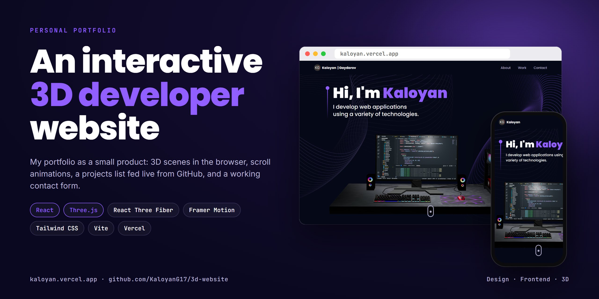

<a href="https://kaloyan.vercel.app"></a>

<p align="center">
  <a href="https://kaloyan.vercel.app"></a>
  
  
  
  
</p>

My personal developer portfolio, built as a small product: 3D scenes that run in the browser, scroll animations, a projects list fed live from GitHub, and a contact form that actually sends email.

---

## 01 · What's on the page

- **Hero:** a 3D desk setup rendered with Three.js and React Three Fiber.
- **Experience:** a vertical timeline of my work and studies.
- **Tech:** floating 3D tech-stack icons.
- **Projects:** cards with tilt effects and live-demo and code links, loaded from GitHub.
- **Contact:** an animated 3D globe next to a form that sends email through EmailJS.

## 02 · Engineering notes

**A 16 MB model cut to 1.4 MB.** The hero's desk-PC model was the biggest thing on the page. I reduced it from 16 MB to 1.4 MB and show a still image while it loads, so the first screen appears quickly even on slow connections.

**Projects come from GitHub, not hard-coded.** [`useGithubProjects`](src/hooks/useGithubProjects.js) fetches my public repositories from the GitHub API, and a short list in the code picks which ones to show. A new project appears on the site without editing its content by hand.

**Motion is scroll-triggered.** Framer Motion animates each section as it scrolls into view, rather than all at once on load.

## 03 · Stack

| Layer | Tools |
| --- | --- |
| UI | React, Tailwind CSS, Framer Motion, react-tilt, react-vertical-timeline-component |
| 3D | Three.js, React Three Fiber, drei, maath |
| Data | GitHub REST API, EmailJS |
| Build and hosting | Vite, Vercel, Vercel Analytics |

## 04 · Run it locally

```bash
npm install
npm run dev
```

---

<p align="center"><sub>Designed and built by <a href="https://github.com/KaloyanG17">Kaloyan Gaydarov</a> · <a href="https://www.linkedin.com/in/kaloyan-gaydarov/">LinkedIn</a></sub></p>
